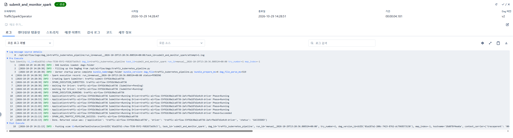
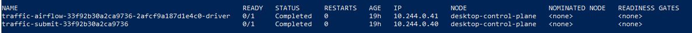
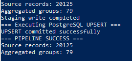
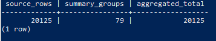
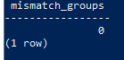
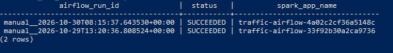

# 🚦 Traffic Data Engineering Portfolio

### End-to-End Batch Pipeline · Kubernetes · Spark · Airflow · Data Observability

**Python · SQL · PostgreSQL · Apache Airflow · Apache Spark · Docker · Kubernetes · Power BI**

교통 측정 데이터를 활용하여 **데이터 수집 → 적재 → 배치 처리 → 분산 실행 → 데이터 품질 검증 → 운영 모니터링 → 이상 탐지 및 패턴 분석**까지 구현한 데이터 엔지니어링 포트폴리오입니다.

단순 분석 리포트를 만드는 데 그치지 않고, 실제 데이터를 처리하는 파이프라인과 작업 실행 상태를 확인할 수 있는 모니터링 환경을 구성했습니다.

---

## 1. Project Overview

### 프로젝트 목표

- Python 기반 CSV 데이터 수집 및 증분 ETL
- PostgreSQL을 활용한 데이터 적재 및 관리
- Apache Airflow 기반 배치 작업 오케스트레이션
- Kubernetes 환경에서 Spark 작업 제출 및 실행 상태 확인
- Spark를 활용한 데이터 집계와 PostgreSQL UPSERT
- SQL 기반 데이터 정합성 검증
- Spark 실행 이력 관리 및 중복 제출 방지
- Power BI를 활용한 데이터 분석 및 운영 모니터링

### 핵심 구현 성과

| 항목 | 결과 |
|---|---|
| 원천 데이터 | **20,125건** |
| Spark 집계 | **79개 그룹** |
| 집계 데이터 총합 | **20,125건** |
| 그룹별 정합성 불일치 | **0건** |
| Airflow DAG | 수동 실행 성공 확인 |
| Kubernetes Spark Driver | 정상 완료 확인 |
| PostgreSQL UPSERT | 성공 |
| 실행 상태 추적 | PostgreSQL 실행 이력 저장 |
| 중복 제출 방지 | 동일 성공 Run ID 재테스트에서 제출 생략 확인 |
| Power BI | 기본 교통량 분석 + 고급 대시보드 3개 |

> 위 수치는 개인 개발 환경에서 확인한 실제 처리 결과입니다. 20,125건의 처리 성공이 곧 대규모 데이터에 대한 성능 우위를 입증하는 것은 아닙니다.

---

## 2. System Architecture

### 전체 데이터 파이프라인

```text
Traffic CSV Files
        |
        v
+--------------------------+
| Python ETL               |
| - CSV Parsing            |
| - Data Cleaning          |
| - Incremental Loading    |
+--------------------------+
        |
        v
+--------------------------+
| PostgreSQL               |
| traffic_raw              |
+--------------------------+
        |
        v
+--------------------------+
| Apache Airflow           |
| Batch Orchestration      |
+--------------------------+
        |
        +--------------------------+
        |                          |
        v                          v
+---------------------+    +--------------------------+
| Kubernetes API      |    | PostgreSQL               |
| Spark Job Submit    |    | spark_job_execution_log  |
+---------------------+    +--------------------------+
        |
        v
+--------------------------+
| Apache Spark             |
| Driver / Executor        |
| Distributed Aggregation  |
+--------------------------+
        |
        v
+--------------------------+
| PostgreSQL               |
| traffic_daily_summary    |
| Staging + UPSERT         |
+--------------------------+
        |
        +--------------------------+
        |                          |
        v                          v
+--------------------+    +-------------------------+
| SQL Data Quality   |    | Power BI                |
| Validation         |    | Traffic Analytics       |
+--------------------+    | Anomaly Detection       |
                          | Traffic Fingerprint      |
                          +-------------------------+

Separate operational data sources
        |
        v
+--------------------------+
| Pipeline Health Monitor  |
| Airflow / Spark / K8s    |
| Execution Observability  |
+--------------------------+
```

### 기술 스택별 역할

| 기술 | 구현 역할 |
|---|---|
| Python | CSV 데이터 처리 및 증분 적재 |
| PostgreSQL | 원천·집계·실행 이력 저장 |
| SQL | 데이터 검증, 집계, UPSERT |
| Apache Airflow | 배치 작업 실행 및 Task 의존성 관리 |
| Apache Spark | 교통 데이터 집계 |
| Kubernetes | Spark Driver·Executor 실행 환경 |
| Docker | 컨테이너 기반 개발 환경 |
| Power BI | 데이터 분석 및 파이프라인 상태 시각화 |

---

## 3. Airflow Batch Pipeline

### 구현 내용

주요 DAG는 `traffic_kubernetes_pipeline`입니다.

```text
submit_and_monitor_spark
           |
           v
validate_traffic_summary
```

#### Task 1 — submit_and_monitor_spark

- PostgreSQL의 Spark 실행 이력 확인
- Kubernetes API를 통한 Spark 작업 제출
- Spark Submitter 생성
- Spark Driver Pod 실행 상태 모니터링
- 실행 결과를 PostgreSQL에 기록

#### Task 2 — validate_traffic_summary

- PostgreSQL 원천 데이터와 집계 데이터 비교
- 집계 그룹 누락 여부 검증
- 차량 수 불일치 검증
- 검증 실패 시 Airflow Task 실패 처리

### Airflow DAG 실행 성공


실제 DAG 실행에서 다음 두 Task가 모두 성공했습니다.

- `submit_and_monitor_spark`
- `validate_traffic_summary`

확인된 실행 중 하나의 전체 DAG 소요시간은 약 **37.7초**입니다.

### Airflow에서 Spark 실행 상태 확인



Task 로그에서 다음 실행 단계를 확인했습니다.

```text
SPARK_EXECUTION_SUBMITTED
SPARK_EXECUTION_RUNNING
Driver Phase=Succeeded
SPARK_K8S_TRAFFIC_PIPELINE_SUCCESS
```

Airflow가 단순히 Python 코드를 실행하는 것뿐 아니라, Kubernetes에 Spark 작업을 제출하고 완료 상태를 감시하도록 구성했습니다.

**관련 소스코드**

- `dags/traffic_kubernetes_pipeline.py`
- `dags/traffic_k8s_client.py`

---

## 4. Kubernetes 기반 Spark 실행

### 구현 목표

Spark 작업을 Kubernetes 환경에 제출하고 Driver·Executor를 사용하여 교통 데이터를 처리하는 실행 구조를 구현했습니다.

주요 구현 내용:

- Kubernetes API 기반 Spark Submitter 생성
- Spark Driver 상태 확인
- ServiceAccount 및 RBAC 설정 활용
- Driver 종료 상태 모니터링
- Airflow Task와 Spark 작업 실행 결과 연동

### Kubernetes 실행 결과



실제 Kubernetes Pod 조회 결과:

| 리소스 | 상태 | Restart |
|---|---|---|
| Spark Submitter | Completed | 0 |
| Spark Driver | Completed | 0 |

이 결과는 Kubernetes 환경에서 제출된 Spark 작업의 Submitter와 Driver가 정상적으로 종료되었음을 보여줍니다.

> `Completed`는 Pod의 정상 종료를 의미합니다. 처리 결과의 정확성은 별도의 Spark 로그 및 SQL 정합성 검증으로 확인했습니다.

---

## 5. Apache Spark 데이터 처리

### Spark Aggregation

Spark는 PostgreSQL에 적재된 교통 데이터를 다음 차원으로 집계합니다.

- `datum` : 측정 날짜
- `source_type` : 수집 유형
- `kfz_klasse` : 차량 종류

집계 결과는 PostgreSQL의 `traffic_daily_summary`에 저장합니다.

### 실제 Spark 실행 결과



실행 로그:

```text
Source records: 20125
Aggregated groups: 79
Staging write completed
=== Executing PostgreSQL UPSERT ===
UPSERT committed successfully
=== PIPELINE SUCCESS ===
```

### 처리 결과

| 항목 | 결과 |
|---|---:|
| 입력 레코드 | 20,125 |
| 집계 그룹 | 79 |
| PostgreSQL UPSERT | 성공 |
| 전체 처리 상태 | 성공 |

중간 테이블에 집계 결과를 저장한 후 UPSERT를 실행하여 최종 집계 테이블에 반영했습니다.

**관련 소스코드**

- `spark/traffic_aggregation.py`
- `spark/write_summary.py`
- `sql/merge_traffic_summary.sql`

---

## 6. Data Quality Validation

데이터 파이프라인에서는 작업 성공 여부뿐 아니라 **처리 결과의 정확성**도 중요하다고 판단했습니다.

따라서 Spark 집계 이후 SQL 기반 정합성 검증을 수행하도록 구성했습니다.

### 6.1 전체 데이터 합계 검증



검증 결과:

| Source Rows | Summary Groups | Aggregated Total |
|---:|---:|---:|
| 20,125 | 79 | 20,125 |

원천 레코드 수와 최종 집계 차량 수의 총합이 일치함을 확인했습니다.

### 6.2 그룹별 정합성 검증



날짜·수집 유형·차량 종류를 기준으로 원천 데이터와 집계 테이블을 비교했습니다.

```sql
WITH source AS (
    SELECT
        datum,
        source_type,
        kfz_klasse,
        COUNT(*) AS cnt
    FROM traffic_raw
    GROUP BY datum, source_type, kfz_klasse
),
summary AS (
    SELECT
        datum,
        source_type,
        kfz_klasse,
        vehicle_count AS cnt
    FROM traffic_daily_summary
)
SELECT COUNT(*) AS mismatch_groups
FROM source s
FULL OUTER JOIN summary t
USING (datum, source_type, kfz_klasse)
WHERE s.cnt IS DISTINCT FROM t.cnt;
```

**검증 결과**

```text
mismatch_groups
---------------
0
```

전체 합계뿐 아니라 그룹별 차량 수도 일치함을 확인했습니다.

---

## 7. Spark 실행 이력 및 중복 제출 방지

### 문제 정의

Airflow 작업을 재실행할 경우 동일한 Spark 작업이 중복 제출될 가능성이 있습니다.

중복 실행은 불필요한 컴퓨팅 자원 사용 및 중복 처리 위험을 증가시킬 수 있으므로, 기존 실행 상태를 확인하는 로직을 구현했습니다.

### 실행 이력 저장

PostgreSQL의 `spark_job_execution_log` 테이블을 활용합니다.

주요 컬럼:

| 컬럼 | 설명 |
|---|---|
| `airflow_run_id` | Airflow 실행 식별자 |
| `spark_app_name` | Spark 애플리케이션 이름 |
| `submitter_name` | Kubernetes Submitter 이름 |
| `status` | 현재 실행 상태 |
| `created_at` | 이력 생성 시각 |
| `updated_at` | 최종 갱신 시각 |

### 실제 실행 이력



두 개의 Spark 실행 이력이 `SUCCEEDED` 상태로 저장된 것을 확인했습니다.

### 중복 제출 방지 로직

```text
Airflow Task 실행
        |
        v
기존 Run ID 조회
        |
        v
이전 상태가 SUCCEEDED인가?
        |
        +-- YES --> Spark 제출 생략
        |           ALREADY_SUCCEEDED
        |
        +-- NO ---> 기존 Pod 및 상태 확인
                    |
                    v
                Spark 작업 제출
```

동일한 성공 Run ID 재테스트에서 `ALREADY_SUCCEEDED` 반환 및 기존 Driver Pod 유지 동작을 확인했습니다.

단, 해당 재테스트 로그의 별도 스크린샷은 현재 보관된 증빙에 포함되어 있지 않습니다.

### 구현 범위와 한계

- 성공 상태 기반 중복 제출 방지: 구현 및 테스트
- 실행 상태의 PostgreSQL 기록: 구현 및 테스트
- 자동 재시도: 비활성화
- 동시 제출의 완전한 원자적 제어: 추가 검증 필요
- Driver Pod 유실 시 자동 복구: 추가 검증 필요
- 전체 상태 전환 이벤트 이력 보관: 미구현

---

# 8. Power BI Advanced Analytics

기존의 단순 교통량 분석을 넘어 데이터 이상 탐지, 데이터 파이프라인 모니터링 및 교통 패턴 분석을 위한 대시보드 3개를 추가로 구성했습니다.

## 8.1 Pipeline Health Monitor

### 데이터 파이프라인 운영 상태 모니터링


Airflow, Spark, Kubernetes 및 데이터 적재 관련 실행 기록을 통합하여 파이프라인 운영 상태를 확인할 수 있도록 구성했습니다.

**주요 지표**

| KPI | 화면 표시값 |
|---|---:|
| Airflow Success Rate | 86.4% |
| Spark Median Lifecycle | 43.0초 |
| Failed Driver Pods | 1 |
| Slow DAG Runs | 2 |

**주요 시각화**

- 날짜별 Airflow 실행 성공·실패 현황
- Spark 관련 Task별 실행시간 비교
- 파일 적재 이벤트별 처리 레코드 수
- Kubernetes Spark Driver 실행 이력
- 실행 날짜, 작업 범위 및 지연 기준 필터

### 구현 의도

데이터 파이프라인이 정상적으로 실행되었는지, 어느 작업에서 실패가 발생했는지, 실행시간이 얼마나 걸렸는지 확인하기 위한 운영 모니터링 화면입니다.

**분석상 주의사항**

- Airflow 실행 기록과 Spark 실행 이력의 집계 범위는 서로 다를 수 있습니다.
- 개발·테스트 중 발생한 실패 기록이 포함될 수 있습니다.
- Spark Lifecycle과 Airflow Task Duration은 동일한 측정 지표가 아닙니다.
- 현재는 실행 상태의 시각화이며 자동 장애 복구 시스템은 아닙니다.

---

## 8.2 Traffic Anomaly Detector

### 교통량 이상 패턴 탐지


교통 데이터를 5분 구간으로 분석하고 관측값을 기준선 및 상·하한과 비교하여 급증·급감 등 이상 후보를 표시하는 대시보드입니다.

**주요 지표**

| KPI | 화면 표시값 |
|---|---:|
| Flagged 5-Minute Bins | 1 |
| Peak Anomaly Score | 53.0 / 100 |
| Risk Level | Watch |
| Analyzed Bins | 362 |

**주요 분석 기능**

- 5분 단위 관측 교통량
- 국소 기준선(Local Baseline)
- 기준 범위의 상한·하한
- 이상 후보 시점 강조
- 날짜별 평균 교통량 비교
- 차종별 최대 이상 점수
- 급증(Surge)·급감(Drop) 구간 표시

### 구현 의도

단순한 교통량 집계를 넘어 시계열 데이터에서 평소 기준과 다른 변화를 식별하고, 문제가 발생한 날짜·시간대·차량 종류를 탐색할 수 있도록 설계했습니다.

### 분석상 주의사항

현재 데이터는 6개 측정 날짜에 한정되어 있으므로, 이 결과는 장기적 정상 패턴을 학습한 예측 모델이 아닌 **제한된 관측 자료에 대한 규칙·기준선 기반 이상 후보 분석**입니다.

이상 점수는 자체 정의한 점수이며 실제 사고 가능성이나 시스템 오류 확률을 의미하지 않습니다.

또한 화면의 이상 구간 KPI와 상세 표의 건수 차이는 집계·필터 기준을 추가 확인해야 합니다.

---

## 8.3 Traffic Fingerprint

### 시간대·측정 지점별 교통 패턴 분석


측정 날짜, 요일, 시간대, 측정 지점 및 차량 종류를 기반으로 교통 패턴의 특징을 비교하기 위해 구성한 대시보드입니다.

**주요 지표**

| KPI | 화면 표시값 |
|---|---:|
| Measured Dates | 6 |
| Observations in Full Bins | 7,770 |
| Covered Site-Hours | 30.2 |
| Vehicles / Site-Hour | 258 |

**주요 분석 기능**

- 요일 × 시간대 교통량 매트릭스
- 평일·주말 시간대별 교통 패턴 비교
- 측정 지점별 시간당 차량 수 비교
- 차종별 구성 및 분포 분석
- 유효 관측시간을 고려한 정규화 지표

### 구현 의도

관측시간이 서로 다른 데이터를 단순 합계로만 비교할 때 발생할 수 있는 왜곡을 줄이기 위해 시간당 차량 수를 활용했습니다.

이를 통해 지점별 시간대 패턴과 차량 구성을 비교할 수 있도록 설계했습니다.

### 분석상 주의사항

- 실제 관측 날짜는 6일입니다.
- 데이터가 없는 시간 구간은 교통량 0과 구분해야 합니다.
- 평일·주말 비교 결과는 관측된 날짜와 지점의 특성입니다.
- 제한된 데이터만으로 일반적인 장기 교통 패턴을 단정하지 않습니다.

---

## 9. 프로젝트에서 배운 기술적 교훈

### 9.1 단순 실행 성공과 데이터 정확성은 다르다

Spark 작업이 성공했다고 해서 데이터가 정확하다고 단정할 수 없습니다.

따라서 집계 이후 PostgreSQL에서 전체 합계 및 그룹별 정합성을 검증하도록 구성했습니다.

### 9.2 중복 실행을 고려해야 한다

Airflow Task가 다시 실행될 때 동일한 Spark 작업이 중복으로 제출될 가능성을 고려하여 실행 이력 기반 재제출 방지 로직을 구현했습니다.

### 9.3 작업 상태를 관찰할 수 있어야 한다

Airflow와 Kubernetes의 실행 상태 및 PostgreSQL 실행 이력을 활용해 작업 성공 여부를 확인하고, Power BI에서 운영 현황을 분석할 수 있도록 확장했습니다.

### 9.4 데이터 비교에서는 측정 범위를 고려해야 한다

`TRACKING`과 `KONTROLLE` 데이터의 관측시간이 서로 다르다는 점을 확인했습니다.

따라서 두 데이터의 단순 총량 차이를 측정 정확도나 오류율로 해석하지 않았으며, 유효 관측시간을 고려한 분석의 필요성을 확인했습니다.

---

## 10. Repository Structure

```text
VE_Traffic/
|
+-- dags/
|   +-- traffic_pipeline.py
|   +-- traffic_kubernetes_pipeline.py
|   +-- traffic_k8s_client.py
|   +-- ...
|
+-- scripts/
|   +-- load_csv.py
|   +-- incremental_load.py
|   +-- ...
|
+-- spark/
|   +-- traffic_aggregation.py
|   +-- write_summary.py
|   +-- benchmark_synthetic.py
|   +-- ...
|
+-- sql/
|   +-- merge_traffic_summary.sql
|   +-- ...
|
+-- docs/
|   +-- screenshots/
|       +-- airflow.png
|       +-- airflow_spark_execution_log.png
|       +-- k8s_spark_driver.png
|       +-- spark_batch_processing.png
|       +-- postgresql_validation.png
|       +-- postgresql_group_validation.png
|       +-- spark_execution_history.png
|
+-- docker-compose.yml
+-- .env.example
+-- .gitignore
+-- .dockerignore
+-- PUBLICATION_NOTES.md
+-- README.md
```

`docs/screenshots/`는 README에서 참조하는 이미지 경로입니다. 실제 파일을 업로드해야 이미지가 표시됩니다.

Power BI 화면을 생성하는 별도 SQL·Python·DAX 코드 중 공개되지 않은 파일은 아직 이 저장소에서 검토할 수 없습니다.

---

## 11. Security and Reproducibility

### 보안 원칙

다음 파일 및 정보는 공개 저장소에서 제외합니다.

- 실제 데이터베이스 비밀번호 및 `.env`
- Kubernetes 인증정보와 로컬 kubeconfig
- SSH 개인 키 및 인증 관련 파일
- 비공개 원천 교통 데이터
- 공개 승인을 받지 않은 Power BI 원본 파일

공개용 코드에서는 데이터베이스 비밀번호를 환경변수로 참조하도록 구성했습니다.

### 실행 환경의 한계

현재 공개 저장소는 프로젝트 구현 방식과 실행 결과를 설명하기 위한 포트폴리오입니다.

Spark Dockerfile, 일부 JDBC 드라이버, 로컬 인증 설정 및 Kubernetes 배포 구성 등의 의존성이 별도로 필요할 수 있으므로 저장소만 내려받아 전체 환경을 즉시 재현할 수 있는 상태는 아닙니다.

또한 공개용으로 보안 설정을 변경한 코드와 실제 실행에 사용한 로컬 환경 사이에는 일부 차이가 있으며, 공개용 코드 전체에 대한 통합 실행 검증은 별도로 필요합니다.

---

## 12. Future Improvements

향후 개선하고 싶은 항목은 다음과 같습니다.

1. Airflow 자동 스케줄링 및 반복 배치 운영 검증
2. Kubernetes Spark Driver 장애·복구 시나리오 테스트
3. 동시 제출 상황에서의 중복 실행 방지 강화
4. Spark Local·Standalone·Kubernetes 실행 성능 비교
5. 이상 탐지 로직의 정답 데이터 기반 평가
6. Pipeline Health Monitor의 자동 알림 기능 확장
7. Data Trust Score 및 Data Drift Monitor 개발
8. Docker·Kubernetes 환경의 재현 가능한 배포 설정 보완
9. Kafka·Flink 기반 실시간 이벤트 처리 파이프라인으로 확장

---

## 13. Project Summary

이 프로젝트를 통해 Python·PostgreSQL 기반 데이터 적재부터 Airflow를 활용한 작업 오케스트레이션, Kubernetes 환경의 Spark 집계 실행, SQL 데이터 정합성 검증, 실행 이력 관리 및 Power BI 모니터링까지 연결했습니다.

특히 다음 세 가지를 중점적으로 구현했습니다.

**1. 데이터 처리 자동화 및 분산 실행**

Python ETL, Airflow, Spark, Kubernetes를 연결한 배치 데이터 파이프라인을 구축했습니다.

**2. 데이터 정확성 및 실행 안정성**

원천 데이터와 집계 결과의 정합성을 검증하고, 성공 이력을 기반으로 Spark 중복 제출을 방지하는 로직을 구현했습니다.

**3. 운영 상태와 데이터 특성의 시각화**

Pipeline Health Monitor, Traffic Anomaly Detector, Traffic Fingerprint를 구성하여 시스템 실행 상태와 데이터의 이상 후보 및 패턴을 분석할 수 있도록 했습니다.

본 프로젝트는 개인 개발 환경에서 구축·검증한 데이터 엔지니어링 포트폴리오이며, 추가적인 운영 안정성 테스트 및 배포 재현성 개선을 진행할 계획입니다.
