# 🚦 Traffic Data Engineering Portfolio

### End-to-End Batch Pipeline | Apache Airflow · Spark · Kubernetes · PostgreSQL

**Tech Stack:** `Python` `SQL` `PostgreSQL` `Airflow` `Spark` `Kubernetes` `Docker` `Power BI`

교통 측정 데이터를 기반으로 **데이터 적재 → 배치 처리 → Kubernetes 기반 Spark 실행 → 데이터 정합성 검증 → 운영 모니터링**까지 구축한 개인 데이터 엔지니어링 프로젝트입니다.

단순 데이터 분석을 넘어, 작업 실행 이력 관리와 중복 제출 방지 로직을 구현하고 실제 실행 결과를 검증했습니다.

## 1. Key Results

| 핵심 지표 | 검증 결과 |
|---|---|
| 원천 데이터 처리 | **20,125 records** |
| Spark 집계 결과 | **79 groups** |
| 그룹별 데이터 불일치 | **0 mismatches** |
| Airflow DAG | **Success** |
| Kubernetes Spark Driver | **Completed** |
| PostgreSQL UPSERT | **Committed successfully** |
| Spark 중복 제출 방지 | 성공한 Run ID 재제출 생략 검증 |

### Airflow DAG Execution

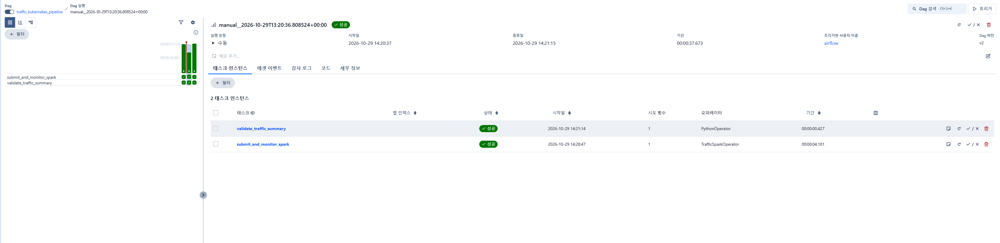

Kubernetes에서 Spark 집계를 실행한 뒤 PostgreSQL 데이터 정합성을 검증하는 두 Task가 모두 성공했습니다.

- `submit_and_monitor_spark`
- `validate_traffic_summary`
- 확인된 DAG 실행 소요시간: **37.7초**

> 개인 개발 환경에서 실제 실행·검증한 결과입니다. Spark의 대규모 데이터 처리 성능이나 상시 운영 안정성을 입증하는 수치는 아닙니다.

---

## 2. System Architecture

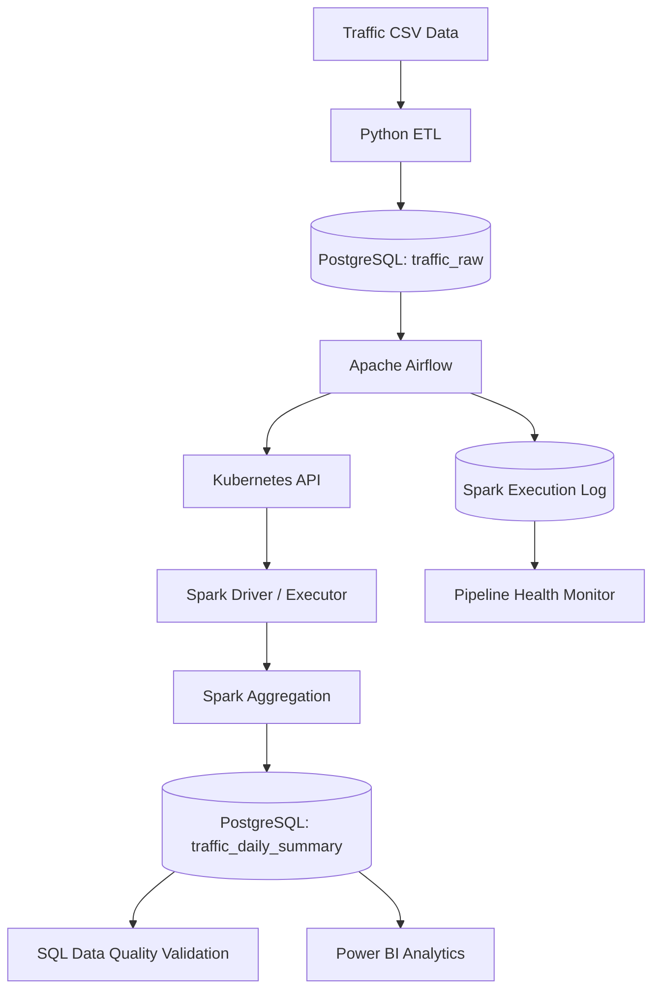

### 주요 기술과 역할

| 기술 | 구현 내용 |
|---|---|
| Python | CSV 데이터 처리 및 증분 ETL |
| PostgreSQL / SQL | 원천·집계 데이터 관리, UPSERT, 정합성 검증 |
| Apache Airflow | DAG 실행, 작업 의존성 및 Spark 실행 상태 관리 |
| Apache Spark | 교통 데이터 집계 |
| Kubernetes | Spark 작업 제출 및 Driver·Executor 실행 |
| Docker | 컨테이너 기반 개발 환경 |
| Power BI | 데이터 분석·이상 탐지·파이프라인 모니터링 |

---

## 3. Core Implementation

### 3.1 Airflow → Kubernetes → Spark

주요 DAG: `traffic_kubernetes_pipeline`

**실행 흐름**

1. Airflow가 PostgreSQL의 Spark 실행 이력을 확인
2. Kubernetes API를 통해 Spark Submitter 생성
3. Spark Driver 실행 상태 모니터링
4. Spark가 PostgreSQL 데이터를 집계
5. 집계 결과를 Staging Table에 저장하고 UPSERT
6. SQL 정합성 검증 후 DAG 완료

**실제 Task 로그**

```text
SPARK_EXECUTION_SUBMITTED
SPARK_EXECUTION_RUNNING
Driver Phase=Succeeded
SPARK_K8S_TRAFFIC_PIPELINE_SUCCESS
```

**Kubernetes 실행 증거**

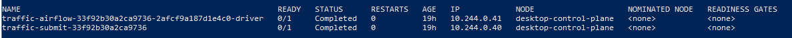

Spark Submitter와 Driver가 모두 `Completed`, 재시작 횟수 `0`으로 종료된 것을 확인했습니다.

**관련 코드**

- [Airflow Kubernetes DAG](dags/traffic_kubernetes_pipeline.py)
- [Kubernetes Spark Client](dags/traffic_k8s_client.py)
- [Spark Aggregation](spark/traffic_aggregation.py)
- [PostgreSQL Summary Writer](spark/write_summary.py)

### 3.2 Spark Aggregation & Data Quality

Spark는 PostgreSQL의 `traffic_raw` 데이터를 다음 기준으로 집계합니다.

- `datum` — 측정 날짜
- `source_type` — 수집 유형
- `kfz_klasse` — 차량 종류

집계 결과를 `traffic_daily_summary`에 반영했습니다.

**실제 처리 결과**

```text
Source records: 20125
Aggregated groups: 79
Staging write completed
UPSERT committed successfully
=== PIPELINE SUCCESS ===
```

집계 이후에는 원천 데이터와 최종 집계 테이블을 `FULL OUTER JOIN`으로 비교하여 누락·불일치 그룹을 검사했습니다.

| 검증 항목 | 결과 |
|---|---:|
| 원천 레코드 | 20,125 |
| 집계 차량 수 합계 | 20,125 |
| 집계 그룹 | 79 |
| 그룹별 불일치 | **0** |

**관련 코드**

- [Spark Aggregation](spark/traffic_aggregation.py)
- [UPSERT SQL](sql/merge_traffic_summary.sql)

<details>
<summary><b>View Spark Processing & Data Validation Evidence</b></summary>

**Spark Batch Processing**

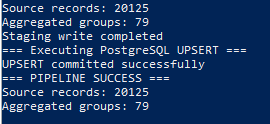

**PostgreSQL Total Validation**

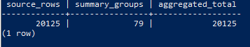

**Group-Level Validation**

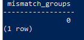

</details>

---

## 4. Reliability & Execution Monitoring

### Spark 중복 제출 방지

**문제:** Airflow Task 재실행 시 동일한 Spark 작업이 다시 제출될 위험이 있습니다.

**해결:** PostgreSQL의 `spark_job_execution_log`에 Airflow Run ID와 Spark 실행 상태를 저장하고, 이미 성공한 Run ID는 재제출하지 않도록 구성했습니다.

```text
Airflow Run
    |
    v
Check Previous Execution
    |
    +-- SUCCEEDED --> Skip Submission
    |                 ALREADY_SUCCEEDED
    |
    +-- Otherwise --> Check Pod State
                      |
                      v
                   Submit Spark
```

**검증 결과**

- Spark 실행 이력 `SUCCEEDED` 저장 확인
- 동일 성공 Run ID 재테스트에서 `ALREADY_SUCCEEDED` 반환 확인
- 기존 Driver Pod 유지 확인

<details>
<summary><b>View Spark Execution History & Airflow Logs</b></summary>

**PostgreSQL Execution History**

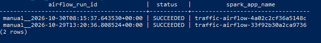

**Airflow Spark Execution Log**

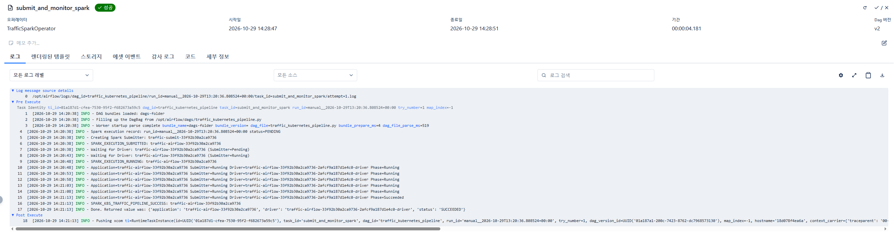

</details>

### 운영상 한계

- 자동 재시도 및 Driver 장애 자동 복구는 추가 검증 필요
- 동시 실행 상황에서의 완전한 중복 제출 제어는 미검증
- 현재 DAG 성공 기록은 수동 실행 기반
- 24시간 상시 운영 안정성은 검증하지 않음

---

## 5. Power BI — Advanced Analytics

데이터 파이프라인 구현 이후, **운영 모니터링과 데이터 이상·패턴 분석**을 위한 Power BI 대시보드 3개를 구성했습니다.

### 5.1 Pipeline Health Monitor

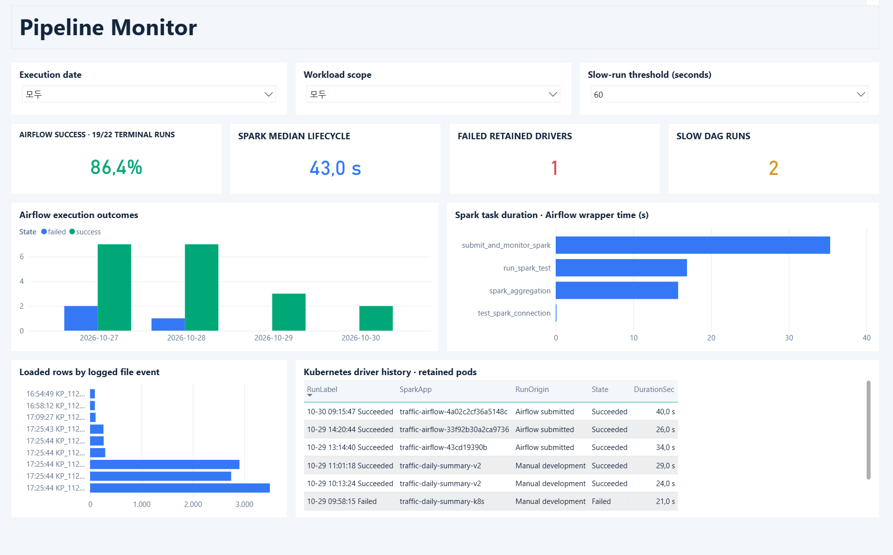

**목적:** Airflow·Spark·Kubernetes의 실행 상태를 통합적으로 확인하는 운영 모니터링 대시보드

주요 기능:

- Airflow DAG 성공률 및 실행 이력
- Spark 작업 실행시간 비교
- Kubernetes Driver 성공·실패 이력
- 지연된 작업 및 파일별 적재량 확인

**핵심 역량:** Data Pipeline Observability · Job Monitoring · Operational Analytics

> 화면의 성공률은 수집된 실행 기록 기준이며, 개발·테스트 기록이 포함될 수 있습니다. 자동 알림·장애 복구 기능까지 구현한 것은 아닙니다.

### 5.2 Traffic Anomaly Detector

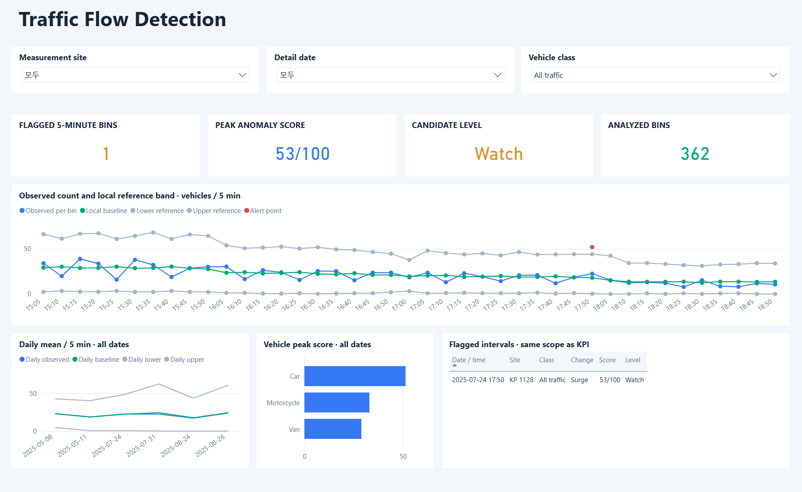

**목적:** 5분 단위 교통량을 기준선과 비교하여 급증·급감 등 이상 후보를 식별

주요 기능:

- 관측 교통량과 국소 기준선 비교
- 상·하한 범위를 이용한 이상 후보 표시
- 차량 종류별 이상 점수
- Surge / Drop 구간 분석

**핵심 역량:** Time-Series Analysis · Anomaly Detection · Data Quality Analytics

> 관측 날짜가 6일로 제한되어 있어 장기 패턴 기반 예측 모델이 아닌 탐색적 이상 탐지입니다. 이상 후보 수의 KPI·상세 표 집계 기준은 최종 검증이 필요합니다.

### 5.3 Traffic Fingerprint

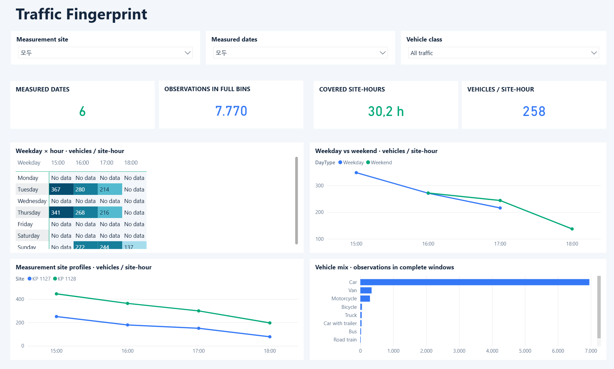

**목적:** 측정 지점·요일·시간대·차량 종류별 교통 패턴 비교

주요 기능:

- 요일 × 시간대 히트맵
- 평일·주말 관측 패턴 비교
- 측정 지점별 시간당 교통량
- 차량 종류별 구성 분석

**핵심 역량:** Data Aggregation · Feature Engineering · Pattern Analysis

> 측정시간이 서로 다른 데이터의 비교를 위해 관측시간을 고려한 지표를 사용했습니다. 분석 결과는 실제 관측된 6일의 데이터 범위로 해석해야 합니다.

---

## 6. Source Code & Repository

| 디렉터리 | 주요 내용 |
|---|---|
| [`dags/`](dags/) | Airflow DAG 및 Kubernetes Spark 연동 |
| [`scripts/`](scripts/) | Python ETL 및 증분 데이터 적재 |
| [`spark/`](spark/) | Spark 집계·저장 및 벤치마크 코드 |
| [`sql/`](sql/) | PostgreSQL SQL 처리 |
| [`docs/screenshots/`](docs/screenshots/) | 실제 파이프라인 실행·검증 증거 |

**환경 설정**

- [Docker Compose](docker-compose.yml)
- [Environment Variables Example](.env.example)
- [Publication Notes](PUBLICATION_NOTES.md)

### Security & Reproducibility

- 데이터베이스 비밀번호 및 인증정보는 공개 저장소에서 제외
- 비공개 원천 데이터와 공개 승인되지 않은 파일은 제외
- Spark 이미지 빌드, JDBC 드라이버, Kubernetes 인증 및 배포 설정 등 별도 환경 구성이 필요
- 공개용 코드 전체에 대한 End-to-End 재실행은 별도 검증 필요

현재 저장소는 **프로젝트 설계·핵심 구현 코드·실제 실행 증거를 보여주는 포트폴리오**이며, 완전히 자동화된 재현 환경은 아닙니다.

---

## 7. Next Steps

1. Airflow 자동 스케줄 및 Kubernetes 장애·복구 테스트
2. Spark 데이터 규모별 처리 성능 벤치마크
3. Kafka·Flink 기반 실시간 이상 이벤트 처리 프로젝트로 확장

---

**Project Focus:** Batch Data Engineering · Distributed Processing · Data Reliability · Pipeline Observability

*Personal Data Engineering Portfolio*
