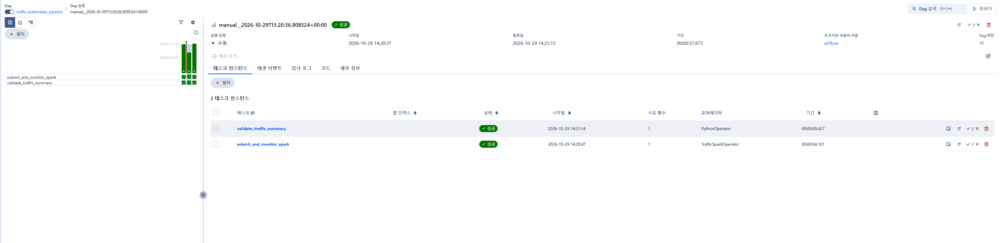

# 🚦 Kubernetes 기반 교통 데이터 엔지니어링 파이프라인

**End-to-End Batch Data Engineering Portfolio**

`Python` · `PostgreSQL` · `Apache Airflow` · `Apache Spark` · `Docker` · `Kubernetes` · `Power BI`

## 1. 프로젝트 소개

본 프로젝트는 교통 측정 데이터를 수집하고, PostgreSQL에 적재한 뒤 Apache Airflow와 Kubernetes 기반 Spark를 활용하여 배치 처리하는 데이터 엔지니어링 프로젝트입니다.

단순한 데이터 분석 및 시각화를 넘어 **데이터 수집 → 적재 → 분산 처리 → 작업 오케스트레이션 → 데이터 품질 검증 → 실행 상태 관리**까지 이어지는 파이프라인을 직접 구현했습니다.

### 프로젝트 핵심 목표

- Python을 이용한 데이터 수집 및 증분 ETL 구축
- PostgreSQL을 활용한 원천·집계 데이터 관리
- Airflow DAG를 통한 배치 작업 오케스트레이션
- Kubernetes 환경에서 Spark Driver·Executor 실행
- SQL 기반 데이터 정합성 검증
- 실행 이력 관리 및 성공한 Spark 작업의 중복 제출 방지
- Power BI를 활용한 교통량 분석 및 시각화

---

## 2. 핵심 구현 성과

| 항목 | 검증 결과 |
|---|---|
| 원천 데이터 처리 | **20,125건** |
| Spark 집계 결과 | **79개 그룹** |
| 집계 기준 | 날짜 · 수집 유형 · 차량 종류 |
| 데이터 정합성 | **불일치 0건** |
| Airflow DAG | 수동 실행 2회 성공 |
| Spark Driver | `Succeeded` |
| Spark 실행 이력 | PostgreSQL에 `SUCCEEDED` 기록 |
| 중복 제출 방지 | `ALREADY_SUCCEEDED` 반환 검증 |
| 기존 Driver 유지 | 재테스트 후 Driver Pod 1개 확인 |

> 위 결과는 개인 개발 환경에서 실제 실행을 통해 확인한 수치입니다. 데이터 처리 건수만으로 대규모 처리 성능을 입증하지는 않습니다.

---

## 3. 시스템 아키텍처

**전체 데이터 처리 흐름**

```text
Traffic CSV Data
        |
        v
Python ETL
        |
        v
PostgreSQL
(traffic_raw)
        |
        v
Apache Airflow DAG
        |
        +------> PostgreSQL
        |        (spark_job_execution_log)
        |
        v
Kubernetes API
        |
        v
Spark Driver / Executor
        |
        v
Spark Aggregation
        |
        v
PostgreSQL
(traffic_daily_summary)
        |
        +------> SQL Data Quality Validation
        |
        v
Power BI Dashboard
```

### 기술별 역할

| 기술 | 역할 |
|---|---|
| Python | 데이터 수집·정제·적재 |
| PostgreSQL | 원천 데이터 및 집계 결과 저장 |
| Airflow | 배치 작업 실행 및 의존성 관리 |
| Spark | 교통량 데이터 집계 |
| Kubernetes | Spark Driver·Executor 실행 환경 |
| Docker | 컨테이너 기반 개발 환경 |
| SQL | UPSERT 및 데이터 정합성 검증 |
| Power BI | KPI 및 분석 대시보드 |

---

## 4. Airflow 배치 파이프라인 실행

### 4.1 DAG 구조

주요 DAG: `traffic_kubernetes_pipeline`

파이프라인은 다음 두 작업으로 구성됩니다.

**Task 1 — `submit_and_monitor_spark`**

- Kubernetes API를 통해 Spark 작업 제출
- 기존 Submitter 및 Driver Pod 확인
- Spark Driver 실행 상태 모니터링
- Spark 실행 결과 PostgreSQL에 기록
- 성공한 작업의 중복 제출 방지

**Task 2 — `validate_traffic_summary`**

- 원천 데이터와 집계 데이터 비교
- 누락된 집계 그룹 확인
- 교통량 합계 불일치 검사
- 검증 실패 시 Task 실패 처리

### 4.2 Airflow DAG 실행 결과



**실제 검증 결과**

| 항목 | 결과 |
|---|---|
| DAG | `traffic_kubernetes_pipeline` |
| DAG Run | `manual__2026-10-29T13:20:36.808524+00:00` |
| `submit_and_monitor_spark` | Success |
| `validate_traffic_summary` | Success |
| 전체 실행 시간 | **37.673초** |
| 각 Task 실행 시도 | 1회 |

Spark 작업과 데이터 정합성 검증 작업이 모두 성공한 것을 확인했습니다.

관련 코드: `dags/traffic_kubernetes_pipeline.py`

---

## 5. Spark 기반 데이터 집계

Spark를 사용하여 PostgreSQL에 저장된 교통 데이터를 다음 기준으로 집계했습니다.

- `datum`: 교통량 측정 날짜
- `source_type`: 데이터 수집 유형
- `kfz_klasse`: 차량 분류

집계 결과는 `traffic_daily_summary`에 저장합니다.

### 집계 결과

| 지표 | 결과 |
|---|---:|
| 원천 데이터 | 20,125 |
| 집계 그룹 | 79 |
| 집계된 차량 수 합계 | 20,125 |
| 검증된 불일치 | 0 |

결과 저장 시 UPSERT 방식을 사용하여 동일한 집계 키에 대한 중복 행 생성을 방지하도록 설계했습니다.

관련 코드:

- `spark/traffic_aggregation.py`
- `spark/write_summary.py`
- `sql/merge_traffic_summary.sql`

---

## 6. Kubernetes 기반 Spark 실행

Spark Standalone 실행 환경을 구성한 후 Kubernetes 기반 Spark 작업 실행으로 확장했습니다.

### 주요 구현 내용

- Kubernetes API를 통한 Spark 애플리케이션 제출
- Spark Submitter Pod 생성 및 상태 확인
- Spark Driver Pod 상태 모니터링
- Kubernetes ServiceAccount 및 RBAC 활용
- PostgreSQL Secret 참조 방식의 인증 정보 전달
- 기존 실행 작업 확인 및 중복 제출 방지

### 실행 상태 관리

Spark 애플리케이션의 실행 상태를 PostgreSQL에 기록하도록 구성했습니다.

상태값:

`PENDING → SUBMITTED → RUNNING → SUCCEEDED / FAILED`

`SUCCEEDED` 최종 상태의 저장과 조회를 실제로 검증했습니다. 다만 각 상태 전환의 전체 이벤트 이력을 별도로 저장하는 구조는 아닙니다.

관련 코드:

- `dags/traffic_k8s_client.py`
- `dags/traffic_kubernetes_pipeline.py`

---

## 7. 실행 안정성 및 중복 제출 방지

### 문제 정의

Airflow 작업이 재실행되면 동일한 Spark 애플리케이션이 중복으로 제출될 가능성이 있습니다.

데이터 파이프라인에서는 중복 실행으로 인해 불필요한 리소스 사용이나 데이터 처리 불일치가 발생할 수 있으므로 이를 방지할 필요가 있습니다.

### 구현 방식

1. Airflow Run ID를 기준으로 Spark Application 이름 생성
2. PostgreSQL에 실행 이력 등록
3. 이전 실행 상태 확인
4. 이미 `SUCCEEDED`인 작업은 재제출하지 않음
5. 기존 Kubernetes Pod 존재 여부 확인

### 검증 결과

동일한 Airflow Run ID로 Spark Task를 다시 테스트한 결과:

```text
Spark execution record: status=SUCCEEDED

Spark execution already succeeded;
skipping submission

Returned:
status=ALREADY_SUCCEEDED
```

재테스트 이후 기존 Spark Driver Pod가 1개로 유지되는 것을 확인했습니다.

### 현재 한계

- 자동 재시도는 비활성화되어 있습니다.
- 모든 Kubernetes 장애 복구 시나리오를 검증하지는 않았습니다.
- 동시 제출에 대한 완전한 원자적 제어는 추가 개선이 필요합니다.
- Driver Pod 유실 시 복구 정책에 대한 추가 테스트가 필요합니다.

---

## 8. 데이터 품질 검증

Spark 집계 이후 Airflow의 데이터 검증 Task를 실행합니다.

검증 항목:

- 원천 데이터와 집계 결과의 그룹 일치 여부
- 누락된 집계 그룹 확인
- 그룹별 차량 수 불일치 확인
- 전체 교통량 합계 확인

실제 검증에서 20,125건의 원천 데이터가 79개 그룹으로 집계되었으며, 불일치가 확인되지 않았습니다.

---

## 9. Power BI 교통량 분석

집계된 데이터를 Power BI Desktop과 연결하여 분석 리포트를 구성했습니다.

### 구현 기능

- 전체 교통량 KPI
- TRACKING 및 KONTROLLE 교통량 비교
- 날짜별 교통량 추이
- 차량 유형별 교통량 분포
- 날짜 슬라이서 기반 동적 필터링

참고로 TRACKING과 KONTROLLE 데이터는 동일한 측정 범위를 가진 데이터인지 확인되지 않았으므로, 두 총량의 차이를 직접적인 AI 측정 오차율로 해석하지 않았습니다.

Power BI 원본 파일은 데이터 공개 가능 여부 검토 후 별도로 제공할 예정입니다.

---

## 10. 프로젝트 구조

```text
VE_Traffic/
├── dags/
│   ├── traffic_pipeline.py
│   ├── traffic_kubernetes_pipeline.py
│   ├── traffic_k8s_client.py
│   └── ...
├── scripts/
│   ├── load_csv.py
│   └── incremental_load.py
├── spark/
│   ├── traffic_aggregation.py
│   ├── write_summary.py
│   ├── benchmark_synthetic.py
│   └── ...
├── sql/
│   └── merge_traffic_summary.sql
├── docs/
│   └── screenshots/
│       └── airflow.png
├── docker-compose.yml
├── .env.example
├── .gitignore
└── README.md
```

`docs/screenshots/`는 실행 증빙 이미지를 저장하기 위한 경로입니다.

일부 Docker 이미지 빌드 파일, 드라이버 및 Kubernetes 인증·배포 설정은 공개 저장소에 포함되지 않았습니다. 따라서 현재 저장소만으로 전체 로컬 환경을 즉시 재현할 수는 없습니다.

---

## 11. 프로젝트에서 중점적으로 학습·구현한 내용

**① End-to-End 데이터 파이프라인**

Python 데이터 적재부터 Spark 집계, SQL 검증, Power BI 분석까지 하나의 데이터 흐름으로 연결했습니다.

**② 배치 처리 및 분산 실행**

Airflow를 통한 배치 작업 실행과 Kubernetes 환경의 Spark Driver·Executor 실행을 구현했습니다.

**③ 데이터 정확성 검증**

단순 집계 결과뿐 아니라 원천 데이터와의 정합성을 SQL로 검증하도록 구성했습니다.

**④ 운영 관점의 설계**

실행 상태 추적, 작업 재실행 판단 및 중복 제출 방지 로직을 추가했습니다.

---

## 12. 향후 개선 계획

- Spark 처리 성능 벤치마크 확장
- Airflow 반복 스케줄 및 운영 테스트
- Kubernetes 장애·복구 시나리오 검증
- Pipeline Health Monitor 구축
- Data Trust Score 계산
- 데이터 이상 탐지 및 분포 변화 감시
- 자동 테스트 및 재현 가능한 배포 환경 정리

---

## 13. 보안 및 공개 범위

실제 데이터베이스 비밀번호, Kubernetes 인증 토큰, SSH 개인 키 및 로컬 환경 설정 파일은 GitHub 공개 대상에서 제외했습니다.

공개용 코드는 비밀번호를 환경변수로 참조하도록 정리했습니다. 공개용 코드와 실제 로컬 실행 환경에는 일부 설정 차이가 있으며, 별도 통합 실행 검증이 필요합니다.

---

## 프로젝트 요약

본 프로젝트를 통해 **Python·SQL 기반 데이터 적재, Airflow 오케스트레이션, Kubernetes 기반 Spark 배치 실행, PostgreSQL 정합성 검증 및 실행 이력 관리**를 연결한 데이터 엔지니어링 파이프라인을 구축했습니다.

단순히 여러 기술을 사용하는 데 그치지 않고, 실제 데이터 처리 결과를 검증하고 중복 작업 제출 문제를 해결하는 과정까지 구현한 개인 프로젝트입니다.
